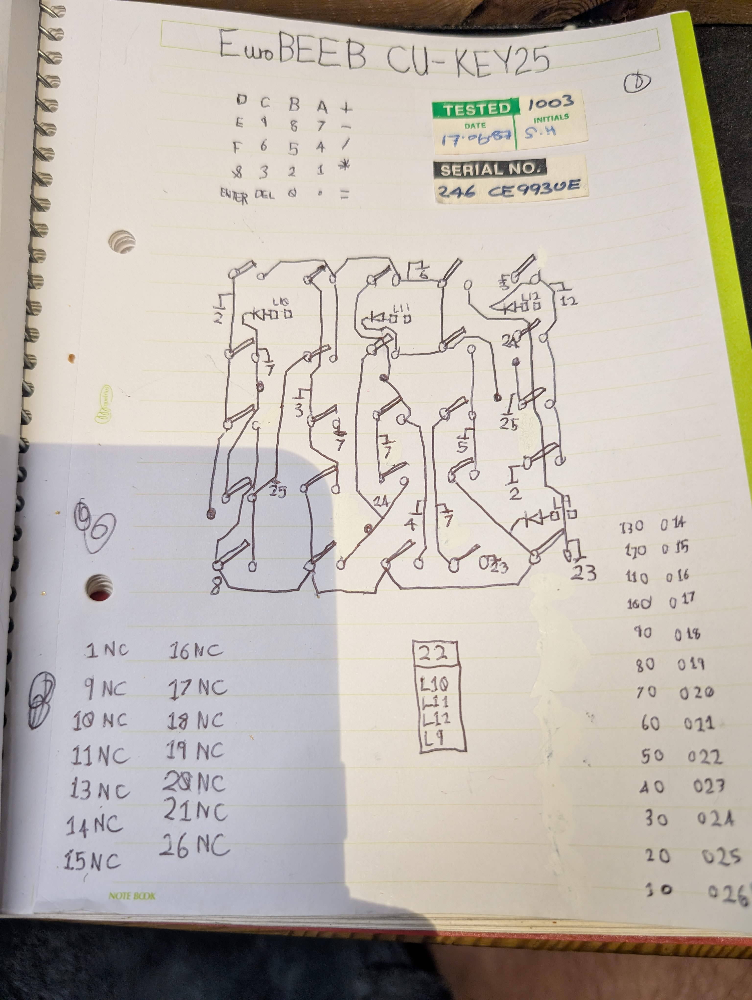

# EuroBEEB-EuroCUBE-65-EPROM-Dumps
Here are the EPROM dumps from a EuroBEEB/EuroCUBE. The computer came out of a computer control unit for a thermal imaging robot that was used to inspect the coils in the generators of nuclear power stations. YouTube video to come. I am currently setting up the computer to run stand alone for my vintage computer setup. As a note this is slowly turning into more than just ROM dumps but a full reverse engineering project, keep checking back to see what has been added. Also blow is my current EuroBEEB/EuroCUBE setup. I also built a cable to connect it to my Windows PC, turned out the BBC Micros serial is compatible with standard RS232.

There are three ROM images:
1. The OS
2. BASIC IV
3. The Custom Control Program

The BASIC listing for the custom application in the optional EPROM is listed in the fire Custom_Application.

I have added a KISS guide to the jumper settings on the EuroBEEB/EuroCube as they are about as clear as mud in the normal manual.

Also added a patched version of the OS ROM that does not start the application on boot, you can still boot said application with:
1. PA=&2000
2. RUN

Added a section on using the keyboard & LCD, these are all supported OS components.

Schematic for Keypad CU-KEY25: [I will make a KiCad one when I get a chance]

