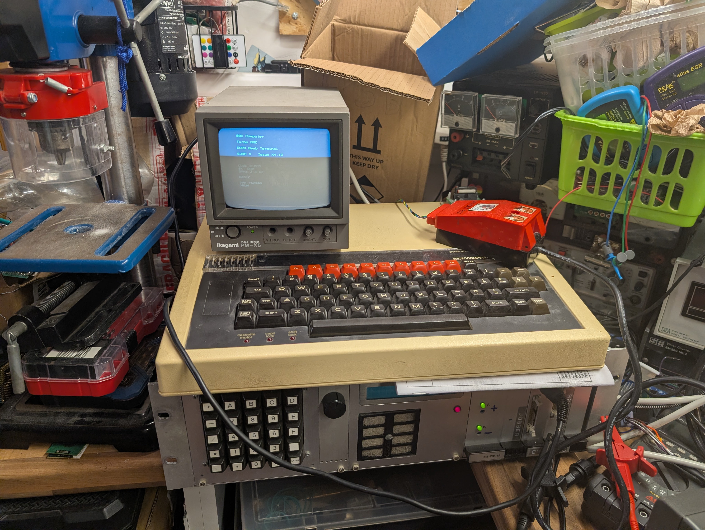

# EuroBEEB-EuroCUBE-65-EPROM-Dumps
Here are the EPROM dumps from a EuroBEEB/EuroCUBE. The computer came out of a computer control unit for a thermal imaging robot that was used to inspect the coils in the generators of nuclear power stations. YouTube video to come. I am currently setting up the computer to run stand alone for my vintage computer setup. As a note this is slowly turning into more than just ROM dumps but a full reverse engineering project, keep checking back to see what has been added. Also blow is my current EuroBEEB/EuroCUBE setup. I also built a cable to connect it to my Windows PC, turned out the BBC Micros serial is compatible with standard RS232.

An important resource that has helped me with what I am doing: https://github.com/croz-tech/EuroBEEB/tree/main



There are three ROM images:
1. The OS
2. BASIC IV
3. The Custom Control Program

The BASIC listing for the custom application in the optional EPROM is listed in the fire Custom_Application.

I have added a KISS guide to the jumper settings on the EuroBEEB/EuroCube as they are about as clear as mud in the normal manual.

Also added a patched version of the OS ROM that does not start the application on boot, you can still boot said application with:
1. PA=&2000
2. RUN

Added a section on using the keyboard & LCD, these are all supported OS components.

Schematic for Keypad CU-KEY25: [I will make a KiCad one when I get a chance]


# Editing The OS ROM

Changes (only the 20-byte BASIC auto-run text at &F003–&F016 cleared; startup byte and language vector preserved):

```
Offset  Old                                         New
F000    0F A0 F1 50 41 2E 3D 26 32 30 30 30 0D ...  0F A0 F1 FF FF FF FF FF FF FF FF FF FF ...
              ^^^^^^^ keep (0F = startup, A0 F1 = &F1A7 language entry)
                      ^ auto-run text replaced by &FF terminator/padding
```

```
Old auto-run: PA.=&2000<CR>RUN<CR>
New auto-run: empty (&FF at &F003)
```
These the edits you need to make to your EuroBEEB OS BIN file, it removes only the auto-run command; then burn/program it to a 27C128 or 27128 EPROM, you could also use a FLASH chip however i have not tested that. You can ether do these edits your self or get AI to do it, ether works.
